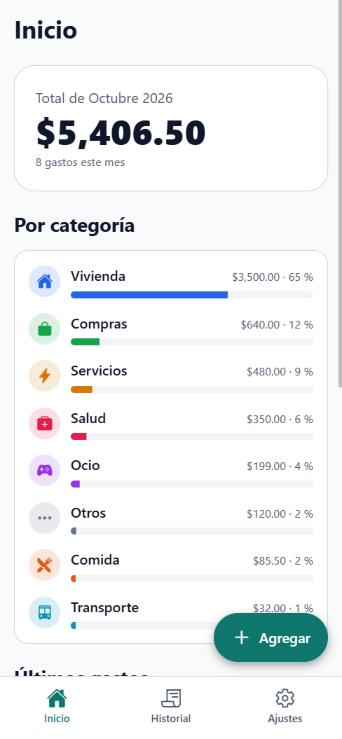
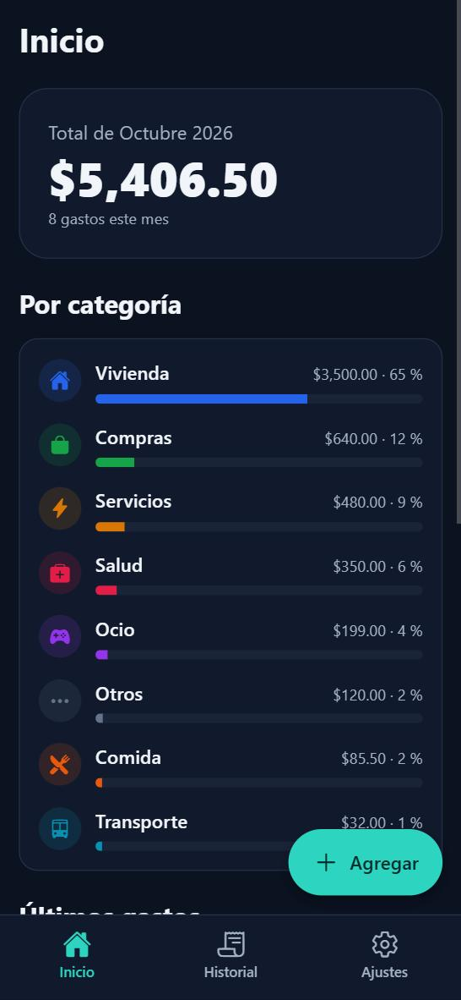
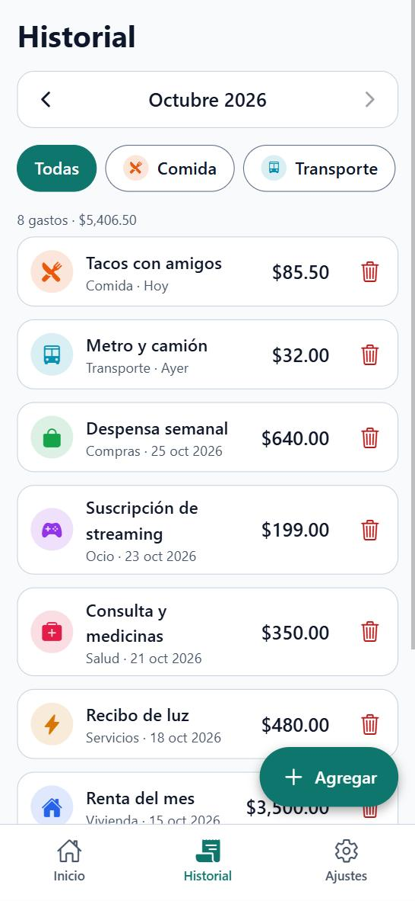
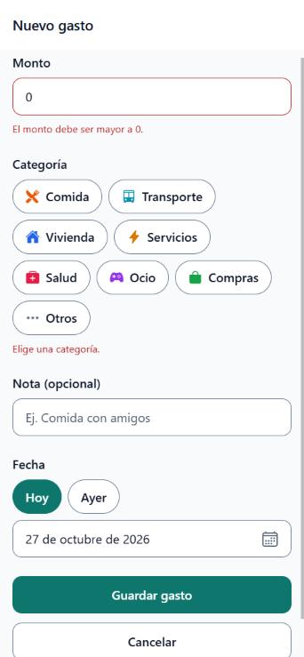

# Control de gastos

App para registrar y revisar gastos personales. Un solo código para **iOS, Android y web**, en español, con tema claro y oscuro. Los datos se guardan en el propio dispositivo (no hay servidor ni cuenta).

| Inicio | Inicio (oscuro) | Historial | Nuevo gasto |
|:---:|:---:|:---:|:---:|
|  |  |  |  |

Ajustes en tema oscuro: [`docs/screenshots/ajustes-oscuro.jpg`](docs/screenshots/ajustes-oscuro.jpg).

> Las capturas son de la versión web exportada, a 390 px de ancho, con los datos de ejemplo.

## Funciones

- **Inicio:** total del mes, gráfica de barras por categoría y los últimos gastos.
- **Agregar y editar gastos:** monto (debe ser mayor a 0), categoría obligatoria, nota opcional y fecha con atajos "Hoy/Ayer" y calendario propio. Los errores se muestran en texto y se quitan al corregir.
- **Historial:** filtro por mes y por categoría, y borrado con confirmación.
- **Ajustes:** tema Sistema, Claro u Oscuro y "Borrar todos los datos".
- **8 categorías fijas**, cada una con icono y color.
- **Datos de ejemplo** la primera vez que se abre la app.
- **Animaciones** con Reanimated (entrada de tarjetas, altas y bajas en la lista, gráfica) que respetan "reducir movimiento", y **vibración ligera** al guardar (solo móvil).
- **Accesibilidad:** etiquetas en español, zonas táctiles de 44 px, contraste WCAG AA verificado por script, foco visible con teclado y diálogo de confirmación con manejo de foco.

El sistema de diseño (paleta, tipografía, espaciado, radios y reglas de animación) está en [DESIGN.md](DESIGN.md).

## Stack

| Qué | Con qué |
|---|---|
| Framework | [Expo](https://docs.expo.dev) SDK 58 (React Native 0.88, React 19.3), TypeScript |
| Navegación | [Expo Router](https://docs.expo.dev/router/introduction/) (pestañas + modal) |
| Estilos | [NativeWind](https://www.nativewind.dev) 4.2 con Tailwind CSS 3 |
| Animación | `react-native-reanimated` 4 |
| Almacenamiento | `@react-native-async-storage/async-storage` (usa `localStorage` en web) |
| Háptica | `expo-haptics` |
| Pruebas | `jest-expo` |

## Cómo correrla

Requisitos: **Node 22.13 o superior** (lo pide Expo SDK 58) y npm.

```bash
npm install
```

```bash
npx expo start --web
```

Para probarla en un teléfono, instala **Expo Go** (iOS/Android), ejecuta lo siguiente y escanea el QR (teléfono y PC en la misma red; si no conecta, usa `npx expo start --tunnel`):

```bash
npx expo start
```

### Otros comandos

| Comando | Qué hace |
|---|---|
| `npm test` | Pruebas unitarias (almacén de gastos, categorías, fechas, validación) |
| `npm run check:contrast` | Verifica el contraste AA de la paleta clara y oscura |
| `npx tsc --noEmit` | Revisa tipos |
| `npm run build:web` | Exporta la versión web a `dist/` |

## Exportar y publicar la versión web

```bash
npm run build:web
```

(equivale a `npx expo export --platform web`). Genera una app de una sola página en la carpeta **`dist/`**, lista para cualquier hosting estático. Para verla localmente tal como saldrá en producción:

```bash
npx serve dist -s
```

### Cloudflare Pages (conectando el repo de GitHub)

1. En el [panel de Cloudflare](https://dash.cloudflare.com), ve a **Workers & Pages → Create → Pages → Connect to Git** y autoriza GitHub.
2. Elige el repositorio y la rama de producción (p. ej. `main`).
3. En **Build settings**:
   - **Framework preset:** `None`
   - **Build command:** `npm run build:web` (o `npx expo export --platform web`)
   - **Build output directory:** `dist`
   - **Root directory:** vacío (la raíz del repo)
4. En **Environment variables** agrega `NODE_VERSION` = `22` (el repo ya incluye `.node-version` con ese valor).
5. **Save and Deploy.** Cada `git push` a la rama de producción vuelve a publicar; las demás ramas y pull requests generan vistas previas.

Cloudflare Pages sirve `index.html` para las rutas que no existen (modo SPA), así que enlaces directos como `/historial` funcionan sin configuración extra, siempre que no agregues un archivo `404.html`.

## Estructura

```
src/
  app/          pantallas (Expo Router): (tabs)/ inicio, historial, ajustes; gasto.tsx
  components/   Button, Chip, CalendarPicker, CategoryChart, ConfirmDialog…
  data/         tipos, categorías, datos de ejemplo y almacén (useExpenses)
  lib/          fechas, dinero, estadísticas, validación, háptica
  theme/        colores (colors.js), tema claro/oscuro y constantes de animación
DESIGN.md       sistema de diseño
```
